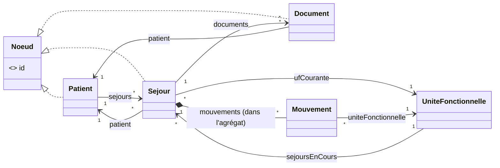

# Tutoriel GraphQL avec Spring Boot : un mini SIH

> **Objectif** : apprendre GraphQL côté serveur avec Spring for GraphQL, sur un domaine réaliste :
> un système d'information hospitalier avec **patients**, **séjours** (et leurs **mouvements**),
> **documents médicaux** et **unités fonctionnelles**.
>
> **Stack** : Java 17, Maven, Spring Boot 3.5, Spring for GraphQL, Spring Data JDBC, Liquibase,
> PostgreSQL 16, Vavr (`Either` pour les erreurs métier), Bean Validation, Reactor (subscriptions), Testcontainers.
>
> Le POC applique les recommandations du livre *GraphQL Best Practices* (Artur Czemiel, Packt, 2024) :
> le chapitre 17 fait la correspondance point par point.

---

## Sommaire

1. [Démarrer le POC](#1-démarrer-le-poc)
2. [Architecture](#2-architecture)
3. [Le domaine hospitalier](#3-le-domaine-hospitalier)
4. [Persistance : Liquibase et Spring Data JDBC](#4-persistance--liquibase-et-spring-data-jdbc)
5. [Le schéma GraphQL](#5-le-schéma-graphql)
6. [Les contrôleurs GraphQL](#6-les-contrôleurs-graphql)
7. [Le problème N+1 et @BatchMapping](#7-le-problème-n1-et-batchmapping)
8. [Scalaires personnalisés](#8-scalaires-personnalisés)
9. [Pagination et filtres](#9-pagination-et-filtres)
10. [Gestion des erreurs](#10-gestion-des-erreurs)
11. [Subscriptions (temps réel)](#11-subscriptions-temps-réel)
12. [Robustesse et sécurité](#12-robustesse-et-sécurité)
13. [Tester une API GraphQL](#13-tester-une-api-graphql)
14. [Catalogue des requêtes de test](#14-catalogue-des-requêtes-de-test)
15. [GraphQL « à la main » avec curl](#15-graphql--à-la-main--avec-curl)
16. [Pour aller plus loin](#16-pour-aller-plus-loin)
17. [Les bonnes pratiques de *GraphQL Best Practices* appliquées](#17-les-bonnes-pratiques-de-graphql-best-practices-appliquées)

---

## 1. Démarrer le POC

### Prérequis

- JDK 17 ou plus
- Maven 3.9+
- Docker (pour PostgreSQL via docker-compose et pour les tests Testcontainers)

### Lancer l'application

```bash
mvn spring-boot:run
```

Grâce à la dépendance `spring-boot-docker-compose`, Spring Boot démarre lui-même le PostgreSQL décrit dans
`docker-compose.yml`, attend qu'il soit prêt, puis branche la DataSource dessus. Liquibase crée ensuite le
schéma et charge le jeu de démonstration.

Si docker a déjà été démarré 
```bash
mvn spring-boot:run "-Dspring-boot.run.arguments=--spring.docker.compose.enabled=false"
```

Variante sans docker-compose, avec un PostgreSQL Testcontainers jetable :

```bash
mvn spring-boot:test-run
```

Variante avec ton propre PostgreSQL : crée une base `sih` (utilisateur `sih` / mot de passe `sih`), puis
lance avec `--spring.docker.compose.enabled=false`.

### Les URL utiles

| URL | Rôle |
|---|---|
| http://localhost:8080/graphiql | IDE GraphQL dans le navigateur (autocomplétion, documentation, historique) |
| http://localhost:8080/graphql | Point d'entrée unique de l'API (POST JSON) |
| ws://localhost:8080/graphql-ws | Subscriptions (WebSocket, protocole `graphql-transport-ws`) |
| http://localhost:8080/graphql/schema | Le schéma complet, tel que le serveur le voit |

**Premier essai** : ouvre GraphiQL et colle :

```graphql
{
  patient(id: 1) {
    prenom
    nomAffiche
    age
    sejours {
      numeroSejour
      statut
      ufCourante { libelle }
    }
  }
}
```

Tape `Ctrl+Espace` n'importe où dans la requête : GraphiQL propose les champs disponibles. C'est
l'**introspection** : le schéma est auto-documenté.

### Lancer les tests

```bash
mvn verify
```

Les tests démarrent un PostgreSQL dans Docker (Testcontainers), jouent les migrations Liquibase et
exécutent les requêtes du catalogue. Il faut donc Docker en marche.

---

## 2. Architecture

Le POC suit une architecture hexagonale légère : le **domaine** et les **services applicatifs** sont du Java
pur (aucune annotation Spring), les **adaptateurs** les relient au monde extérieur.

```
                 ┌──────────────────── api.graphql (adaptateur primaire) ───────────────────┐
  Client ──HTTP──▶ PatientController  SejourController  DocumentController  RelationsController │
  Client ───WS───▶ EvenementsController  TransverseController  GestionnaireErreursGraphql     │
                 └──────────────────────────────────┬───────────────────────────────────────┘
                                                    │ appelle
                 ┌──────────────────────── application (cas d'usage) ───────────────────────┐
                 │ PatientService  SejourService  DocumentService  RechercheService  ...    │
                 └──────────────────────────────────┬───────────────────────────────────────┘
                                                    │ utilise les ports
                 ┌──────────────────────────── domaine (Java pur) ──────────────────────────┐
                 │ Patient  Sejour  Mouvement  Document  UniteFonctionnelle  EvenementSih   │
                 │ Ports : PatientRepository, SejourRepository, PublicateurEvenements, ...  │
                 └──────────────────────────────────▲───────────────────────────────────────┘
                                                    │ implémentent
                 ┌──────────────── infrastructure (adaptateurs secondaires) ────────────────┐
                 │ *RepositoryAdapter + *Entity (Spring Data JDBC)   StatistiquesJdbcAdapter │
                 │ FluxEvenementsSih (Reactor Sinks)                 TransactionsSpring      │
                 └──────────────────────────────────┬───────────────────────────────────────┘
                                                    ▼
                                         PostgreSQL (schéma Liquibase)
```

| Paquet | Contenu |
|---|---|
| `domaine` | Agrégats (records immuables), règles métier renvoyant `Either<ErreurMetier, T>`, commandes, filtres, ports |
| `application` | Services : pipelines d'`Either`, transactions (rollback sur `Left`), publication d'événements |
| `infrastructure.persistance` | Entités de persistance, repositories Spring Data JDBC, adaptateurs des ports |
| `infrastructure.evenement` | Bus d'événements en mémoire (Reactor) |
| `api.graphql` | Contrôleurs, inputs validés, scalaires, conversion `Either` → union GraphQL, masquage des erreurs, calcul de coût |
| `config` | `ApplicationConfiguration` : tout le câblage explicite (`@Bean`) |

**Le trajet d'une requête** `{ sejour(id: 3) { motif patient { prenom } } }` :

1. graphql-java parse la requête et la **valide** contre le schéma (champ inconnu → rejet immédiat).
2. Pour le champ racine `sejour`, il appelle le *DataFetcher* enregistré : `SejourController.sejour(Long id)`.
3. Le contrôleur appelle `SejourService.trouver`, qui interroge le port `SejourRepository`, implémenté par
   `SejourRepositoryAdapter` (Spring Data JDBC).
4. Pour `motif`, graphql-java lit simplement l'accesseur `motif()` du record `Sejour`.
5. Pour `patient`, il appelle le `@BatchMapping` de `RelationsController` (chargement en lot).
6. La réponse JSON reproduit exactement la forme de la requête.

---

## 3. Le domaine hospitalier

### Vocabulaire

| Terme | Signification |
|---|---|
| **IPP** | Identifiant permanent du patient dans l'établissement |
| **Séjour** | Une venue du patient : hospitalisation complète, ambulatoire, passage aux urgences, consultation externe |
| **NDA** | Numéro de dossier administratif = `numeroSejour` (généré par une séquence : année + 6 chiffres) |
| **UF** | Unité fonctionnelle : maille d'activité (ex. *1202 – USIC*) |
| **Mouvement** | Entrée, mutation (changement d'UF), sortie |
| **Lettre de liaison** | Document remis au patient à la sortie d'hospitalisation |

### Les agrégats

- **Patient** : identité (nom de naissance, nom d'usage, prénom, date de naissance, sexe).
- **Séjour** : racine d'agrégat qui **contient** ses mouvements. Le patient n'est référencé que par son id :
  c'est un autre agrégat.
- **Document** : rattaché à un séjour, cycle de vie `BROUILLON → VALIDE`.
- **UniteFonctionnelle** : référentiel en lecture seule.

Le livre recommande de **dessiner les relations avant d'écrire les champs** : c'est ce dessin qui révèle
les types manquants et les chemins d'accès. Le graphe exposé par le schéma :



Le cycle `Patient → Sejour → Patient` est légitime (navigation dans les deux sens) mais permet des requêtes
infiniment profondes : il faut donc le protéger (chapitre 12).

### Règles métier implémentées

Chaque règle produit une `ErreurMetier` dont le code (enum `CodeErreur`, identique côté Java et côté
schéma) est stable et documenté dans le schéma.

| Code d'erreur | Règle | Où |
|---|---|---|
| `IPP_DEJA_UTILISE` | Un IPP est unique | `PatientService.creer` |
| `SEJOUR_DEJA_EN_COURS` | Un seul séjour « lit » (hors consultation) en cours par patient | `SejourService.admettre` |
| `DATE_FUTURE` | Pas d'admission dans le futur | `SejourService.admettre` |
| `MUTATION_MEME_UF` | On ne mute pas vers l'UF courante | `Sejour.muter` |
| `CHRONOLOGIE_INVALIDE` | Un mouvement ne précède jamais le précédent | `Sejour` |
| `SEJOUR_NON_EN_COURS` | Mutation, sortie, annulation uniquement sur un séjour en cours | `Sejour` |
| `LETTRE_LIAISON_MANQUANTE` | Sortie d'hospitalisation complète ou ambulatoire : lettre de liaison **validée** obligatoire (sauf décès) | `SejourService.sortir` |
| `SEJOUR_ANNULE` | Pas de document sur un séjour annulé | `DocumentService.ajouter` |
| `DOCUMENT_DEJA_VALIDE` | On ne revalide pas | `Document.valider` |
| `DOCUMENT_VALIDE_NON_SUPPRIMABLE` | Seul un brouillon est supprimable | `Document` |
| `PAGINATION_INVALIDE` | Taille de page entre 1 et 100 | `Pagination` |
| `RECHERCHE_TROP_COURTE` | Au moins 2 caractères | `RechercheService` |
| `VALIDATION` | Contraintes Bean Validation des inputs (champs obligatoires non vides, longueurs, date passée) | `ValidateurEntrees` |
| `RESSOURCE_INTROUVABLE` | Patient, séjour, document ou UF inexistant | `ErreurMetier.trouve` |

### Le jeu de démonstration (ids fixes)

| Patient (id) | Situation |
|---|---|
| 1 – MARTIN Jeanne | Séjour 1 clos (urgences → USIC → cardio, 4 documents) + séjour 2 en cours en cardiologie |
| 2 – BERNARD Louis | Séjour 3 en cours en orthopédie (CRO validé, ordonnance brouillon id 8) |
| 3 – DUBOIS (LEFEVRE) Claire | Ambulatoire clos + consultation close |
| 4 – PETIT Hugo | Mineur, passage aux urgences clos |
| 5 – MOREAU Élise | Séjour 7 en cours aux urgences |
| 6 – LAURENT Paul | Séjour 8 **annulé** + séjour 9 en cours en médecine interne |
| 7 – GARCIA Sofia | Infarctus, séjour clos par transfert |
| 8 – ROUX Henri | Séjour 11 en cours (pneumopathie) |
| 9 – FOURNIER Nathalie | Séjour 12 ambulatoire en cours, **sans lettre de liaison** |
| 10 – GIRARD Lucas | Aucun séjour |
| 11 – BONNET (MERCIER) Marie | Consultation close |
| 12 – LAMBERT Camille | Sexe indéterminé, urgences clos |

---

## 4. Persistance : Liquibase et Spring Data JDBC

### Liquibase

`db/changelog/db.changelog-master.yaml` inclut deux fichiers au format **SQL formaté** Liquibase :

- `001-schema.sql` : un `changeset` par table, avec `--rollback`.
- `002-donnees-demo.sql` : le jeu de démonstration, marqué `context:demo`.

```sql
--liquibase formatted sql

--changeset sih:002-patient
CREATE TABLE patient ( ... );
--rollback DROP TABLE patient;
```

`spring.liquibase.contexts: demo` active les données de démonstration. En production, on lancerait sans ce
contexte et seul le schéma serait appliqué. Liquibase mémorise les changesets joués dans la table
`databasechangelog` : **ne jamais modifier un changeset déjà joué**, en ajouter un nouveau.

### Spring Data JDBC en 6 idées

Spring Data JDBC est volontairement plus simple que JPA/Hibernate :

1. **Pas de session, pas de lazy loading, pas de dirty checking.** `save()` écrit, `findById()` lit. Point.
2. **Un repository par agrégat.** Tout ce qui est dans l'agrégat est chargé et sauvegardé avec la racine.
3. **Les relations entre agrégats se font par identifiant** (`Long patientId`), jamais par référence d'objet.
4. **Les collections internes** (`List<MouvementEntity>` dans `SejourEntity`) sont *supprimées puis
   ré-insérées* à chaque `save()`. Simple et prévisible, mais à éviter pour de très grosses collections.
5. **Les records immuables sont supportés** : pour un id généré par la base, Spring Data appelle la méthode
   `withId(...)` du record.
6. **Le SQL reste accessible** : `@Query`, `JdbcAggregateTemplate`, `JdbcClient`.

```java
@Table("sejour")
public record SejourEntity(
        @Id Long id,
        String numeroSejour,
        Long patientId,                       // autre agrégat : simple id
        ...
        @MappedCollection(idColumn = "sejour_id", keyColumn = "ordre")
        List<MouvementEntity> mouvements) {    // entités internes à l'agrégat
```

**Pourquoi des `*Entity` séparées des objets du domaine ?** Pour garder le domaine sans annotation, et
stocker les énumérations en `String` sans que le domaine le sache. Le prix : un mapper (`depuis()` /
`versDomaine()`) par agrégat.

### Quatre façons de requêter (toutes présentes dans le code)

| Technique | Exemple | Usage |
|---|---|---|
| Méthodes héritées | `findById`, `findAllById`, `save` | CRUD |
| Requêtes dérivées | `findByPatientIdInOrderByDateEntreeDesc(...)`, `existsByIpp(...)` | Requêtes simples |
| `@Query` | `rechercherTexte` (ILIKE + LIMIT) | SQL spécifique PostgreSQL |
| `JdbcAggregateTemplate` + `Criteria` | `PatientRepositoryAdapter.rechercher` | Filtres dynamiques et pagination |
| `JdbcClient` | `StatistiquesJdbcAdapter`, séquence NDA | Lecture « reporting », agrégations |

Recherche multicritère dynamique :

```java
List<Criteria> criteres = new ArrayList<>();
if (filtre.nom() != null) {
    criteres.add(Criteria.where("nomNaissance").like(contient(filtre.nom())).ignoreCase(true)
            .or("nomUsage").like(contient(filtre.nom())).ignoreCase(true));
}
if (filtre.sexe() != null) {
    criteres.add(Criteria.where("sexe").is(filtre.sexe().name()));
}
Page<PatientEntity> page = template.findAll(Query.query(Criteria.from(criteres)),
        PatientEntity.class, PageRequest.of(page, taille, Sort.by("nomNaissance", "prenom", "id")));
```

> 💡 `logging.level.org.springframework.jdbc.core.JdbcTemplate: DEBUG` (déjà activé) affiche tout le SQL
> exécuté. Garde un œil sur la console pendant tout le tutoriel.

---

## 5. Le schéma GraphQL

Spring for GraphQL est **schema-first** : on écrit le contrat dans des fichiers `.graphqls`
(`src/main/resources/graphql/`), puis on le relie au code. Tous les fichiers sont fusionnés ; chaque domaine
**étend** les types racines :

```graphql
# commun.graphqls
type Query { recherche(...): [Noeud!]  statistiques: Statistiques! ... }

# sejour.graphqls
extend type Query { sejour(id: ID!): Sejour ... }
extend type Mutation { admettrePatient(entree: AdmissionInput!): Sejour! ... }
```

### Le système de types, illustré par le POC

| Concept | Exemple | Remarque |
|---|---|---|
| Type objet | `type Patient { ... }` | Les champs peuvent avoir des arguments : `documents(type: TypeDocument)` |
| Scalaires standard | `ID`, `String`, `Int`, `Float`, `Boolean` | `ID` est sérialisé en chaîne |
| Scalaires personnalisés | `Date`, `DateHeure`, `IPP`, `Telephone` | Format documenté une seule fois, validé à l'entrée (chapitre 8) |
| Énumération | `enum StatutSejour { EN_COURS CLOS ANNULE }` | Mappée sur l'enum Java du même nom |
| Input | `input AdmissionInput { ... }` | Seuls types autorisés en argument (avec scalaires/enums) ; un input dédié par action |
| Interface | `interface Noeud { id: ID! }`, `interface EvenementSih` | Champs communs ; `... on Sejour` pour le reste |
| Union | `union ResultatSejour = Sejour \| ErreurMetier` | Aucun champ commun ; fragments inline obligatoires |
| Directive de schéma | `@cout(multiplicateur: "taille")`, `@deprecated(reason: ...)` | Métadonnées sur les champs (coût, dépréciation) |
| Non-null | `String!`, `[Sejour!]!` | Voir la propagation des null au chapitre 10 |
| Description | `"Numéro de dossier administratif"` | Visible dans la doc de GraphiQL ; Markdown accepté (exemples de requêtes) |

### Conventions du schéma

Le livre insiste : une incohérence de nommage coûte du temps à chaque lecteur du schéma. Le POC applique :

| Élément | Convention | Exemple |
|---|---|---|
| Types, inputs, enums, unions | PascalCase, langage métier français | `Sejour`, `AdmissionInput`, `ResultatSejour` |
| Champs et arguments | camelCase | `numeroSejour`, `dateEntree` |
| Valeurs d'énumération | MAJUSCULES | `HOSPITALISATION_COMPLETE` |
| Inputs | suffixe `Input`, un par action | `SortieInput`, `MutationPatientInput` |
| Mutations | un verbe d'action métier, un seul argument `entree` | `sortirPatient(entree: SortieInput!)` |
| Retour de mutation | union `Resultat<Objet>` | `ResultatDocument = Document \| ErreurMetier` |
| Identifiants | type `ID`, jamais `String` ou `Int` | `id: ID!`, `patientId: ID!` |
| Formats métier | scalaire dédié et documenté | `ipp: IPP!`, `telephone: Telephone` |
| Listes paginées | `{ contenu, infoPage }` | `PatientPage`, `SejourPage` |

Des **mutations d'action** (`admettrePatient`, `muterPatient`, `sortirPatient`, `annulerSejour`) plutôt qu'un
`modifierSejour` générique : le schéma dit lui-même ce qu'on peut faire d'un séjour, et chaque action a ses
propres règles et événements.

### Documenter tout le schéma

Chaque type, champ, argument, valeur d'énumération et champ d'input porte une description : unités, formats,
bornes de longueur, valeur par défaut, erreurs possibles. Les opérations racines contiennent en plus un
**exemple de requête en Markdown**. Ouvre l'onglet *Docs* de GraphiQL : c'est la documentation de référence
de l'API, toujours à jour puisqu'elle est le contrat lui-même.

### Faire évoluer sans casser : `@deprecated`

```graphql
type Mouvement {
    ufCode: String! @deprecated(reason: "Utiliser uniteFonctionnelle { code }. Ce champ sera supprimé dans une prochaine version.")
    uniteFonctionnelle: UniteFonctionnelle!
}
```

Le champ fonctionne toujours, mais GraphiQL le barre et l'introspection l'annonce (`q17`). On le supprime
une fois les clients migrés, au lieu de casser leurs requêtes du jour au lendemain.

### Query, Mutation, Subscription

- **Query** : lecture. Les champs racines peuvent s'exécuter en parallèle.
- **Mutation** : écriture. Les champs racines s'exécutent **en série, dans l'ordre** (requête `m19`).
- **Subscription** : flux d'événements (chapitre 11).

### Comment un champ est-il résolu ?

Par ordre de priorité :

1. Une méthode de contrôleur annotée (`@QueryMapping`, `@SchemaMapping`, `@BatchMapping`…).
2. Sinon, le **PropertyDataFetcher** de graphql-java lit la propriété sur l'objet parent : getter, champ
   public, ou **méthode de même nom** (accesseurs de record, et méthodes calculées comme
   `Patient.nomAffiche()`, `Document.taille()`, `PageResultat.totalPages()`).

Au démarrage, Spring for GraphQL **inspecte** le schéma et logue les champs qu'il ne sait pas résoudre
(`spring.graphql.schema.inspection.enabled`). Très utile pour repérer une faute de frappe.

---

## 6. Les contrôleurs GraphQL

```java
@Controller
public class SejourController {

    @QueryMapping                                     // champ Query.sejour
    public Sejour sejour(@Argument Long id) { ... }   // ID "3" converti en Long

    @MutationMapping                                  // champ Mutation.admettrePatient
    public Object admettrePatient(@Argument AdmissionInput entree) {
        return Resultats.enUnion(validateur.valider(entree)      // Either<ErreurMetier, AdmissionInput>
                .map(AdmissionInput::versCommande)
                .flatMap(sejourService::admettre));             // Either<ErreurMetier, Sejour>
    }                                                           // -> Sejour OU ErreurMetier

    @SchemaMapping(typeName = "Sejour")               // champ Sejour.dureeJours
    public long dureeJours(Sejour sejour) { ... }     // 1er paramètre = objet parent ("source")
}
```

Points clés :

- **Le nom de la méthode est le nom du champ** (sinon `field = "..."`).
- `@Argument` lit un argument du champ. Les **inputs** sont instanciés automatiquement dans des **records**
  via leur constructeur canonique, y compris les listes d'enums (`FiltreSejour.statuts`) et les scalaires
  personnalisés déjà convertis.
- Les **filtres** (`FiltrePatient`, `FiltreSejour`, `FiltreDocument`) sont des records du domaine utilisés
  directement comme arguments. Les **inputs de mutation** (`CreerPatientInput`…) vivent dans l'API car ils
  portent les annotations Bean Validation ; ils se convertissent en commandes du domaine via
  `versCommande()`.
- Une mutation renvoie `Object` : la valeur ou l'`ErreurMetier`. Spring for GraphQL choisit le membre de
  l'union d'après le **nom simple de la classe Java** renvoyée (`Sejour`, `ErreurMetier`, `DocumentSupprime`).
- Un champ **calculé** (`Patient.age`, `Sejour.dureeJours`) ou **avec argument**
  (`Document.contenu(longueurMax)`, `Patient.documents(type)`) passe par `@SchemaMapping`.
- Un champ dont le type Java ne correspond pas au type GraphQL doit être mappé : `Sejour.ufCourante` est un
  `String` en Java mais un objet `UniteFonctionnelle` en GraphQL.

### Résolution paresseuse : l'exemple des statistiques

```java
@QueryMapping
public StatistiquesRacine statistiques() { return new StatistiquesRacine(); } // objet vide

@SchemaMapping(typeName = "Statistiques")
public long nombrePatients() { return statistiquesService.nombrePatients(); }
```

Chaque indicateur n'est calculé **que si le client le demande**. Compare les logs SQL de `q35` (5 requêtes)
et `q36` (une seule).

---

## 7. Le problème N+1 et @BatchMapping

C'est LE piège classique de GraphQL. Lance la requête `q24-n-plus-1-vs-batch` et regarde la console :

```graphql
patients(taille: 12) {
  contenu {
    sejourEnCours { numeroSejour }   # @SchemaMapping : appelé 12 fois → 12 SELECT
    sejours { numeroSejour }         # @BatchMapping  : appelé 1 fois  → 1 SELECT ... WHERE patient_id IN (...)
  }
}
```

### Comment fonctionne @BatchMapping

graphql-java résout la requête **niveau par niveau**. Pour un champ en `@BatchMapping`, il collecte toutes
les sources du niveau (les 12 patients), puis appelle **une seule fois** la méthode avec la liste :

```java
@BatchMapping(typeName = "Patient", field = "sejours")
public Map<Patient, List<Sejour>> sejoursDuPatient(List<Patient> patients) {
    Map<Long, List<Sejour>> parPatient = sejourService.parPatientIds(ids(patients, Patient::id)).stream()
            .collect(Collectors.groupingBy(Sejour::patientId));
    return associer(patients, p -> parPatient.getOrDefault(p.id(), List.of()));
}
```

Sous le capot, Spring enregistre un **DataLoader** (bibliothèque java-dataloader) par champ. Deux règles :

1. **Chaque source doit avoir une entrée dans la Map**, sinon le champ vaut `null`, ce qui casse un champ
   non-nullable comme `[Sejour!]!`. D'où le `getOrDefault(..., List.of())`.
2. **Pas d'argument possible** sur un champ `@BatchMapping`. Pour `Patient.documents(type: ...)`, on est
   resté en `@SchemaMapping` (donc N+1). Solution avancée : un DataLoader enregistré à la main via
   `BatchLoaderRegistry`, dont la clé combine l'id et l'argument.

Dans le POC, toutes les relations **entre agrégats** (`Sejour.patient`, `Sejour.documents`,
`Sejour.ufCourante`, `Document.sejour`, `Document.patient`, `Mouvement.uniteFonctionnelle`,
`UniteFonctionnelle.sejoursEnCours`…) sont en batch. Les mouvements, internes à l'agrégat Séjour, sont
chargés avec lui et ne coûtent aucune requête supplémentaire au niveau GraphQL.

---

## 8. Scalaires personnalisés

GraphQL ne connaît pas les dates. On déclare `scalar Date` et `scalar DateHeure` dans le schéma, puis on fournit
leur implémentation (`Scalaires.java`). Un scalaire, ce sont trois conversions :

| Méthode | Sens | Exemple |
|---|---|---|
| `serialize` | Java → JSON (réponse) | `LocalDate` → `"1948-03-12"` |
| `parseValue` | variable JSON → Java | `$neApres: "2008-11-19"` → `LocalDate` |
| `parseLiteral` | littéral dans la requête → Java | `neApres: "2008-11-19"` → `LocalDate` |

Enregistrement :

```java
@Bean
RuntimeWiringConfigurer scalairesSih() {
    return wiring -> wiring.scalar(Scalaires.DATE).scalar(Scalaires.DATE_HEURE);
}
```

Les scalaires **métier** `IPP` et `Telephone` sont des `String` côté Java, mais leur format (8 chiffres,
10 chiffres commençant par 0) est décrit une seule fois dans le schéma au lieu d'être répété sur chaque
champ, et vérifié à l'entrée : `patientParIpp(ipp: "12AB")` est refusé avant exécution (`e08`).

`DateHeure` est une date-heure **locale** (sans fuseau), comme dans la plupart des SIH et des messages HL7.
La sérialisation tronque à la seconde : `2026-11-18T09:30:00`. Une valeur mal formée est rejetée à la
validation, avant tout appel au code (`e04`).

> On aurait pu utiliser `graphql-java-extended-scalars`, qui fournit `Date`, `DateTime`, `Long`, `JSON`… Les
> écrire une fois à la main aide à comprendre ce qui se passe.

---

## 9. Pagination et filtres

### Pagination par offset

```graphql
patients(filtre: FiltrePatient, page: Int = 0, taille: Int = 20): PatientPage!

type PatientPage { contenu: [Patient!]!  infoPage: InfoPage! }
type InfoPage    { page: Int!  taille: Int!  totalElements: Int!  totalPages: Int!  estDernierePage: Boolean! }
```

- Les **valeurs par défaut** sont déclarées dans le schéma : le contrôleur reçoit toujours une valeur.
- GraphQL n'a pas de génériques : un type `XxxPage` par entité, mais les métadonnées sont **factorisées**
  dans un type `InfoPage` commun (comme le `PageInfo` du livre), et un seul record Java `PageResultat<T>` sert
  pour toutes les pages (sa méthode `infoPage()` alimente le champ du même nom).
- La taille est bornée à 100 (`e03`) : en GraphQL, le client choisit ce qu'il demande, le serveur doit donc
  fixer des limites.

> L'alternative standard est la pagination par **curseur** (spécification *Connections* de Relay :
> `edges`, `node`, `pageInfo`, `after`). Spring for GraphQL la gère avec `ScrollSubrange` ; c'est un bon
> exercice (chapitre 16).

### Filtres

Des **input types** dont tous les champs sont optionnels, combinés en ET côté SQL. On peut les écrire en
littéral (`q09`) ou les passer en variable (`q10`, `q28`), ce qui est la bonne pratique : la requête reste
constante (et cacheable), seules les variables changent.

---

## 10. Gestion des erreurs

Le livre distingue les erreurs **attendues** (une règle métier refuse l'action) des erreurs **inattendues**
(bug, base indisponible). Les premières font partie du contrat et doivent être **typées dans le schéma** ;
les secondes doivent être **masquées**. Le POC suit cette ligne avec `Either` de Vavr de bout en bout.

### 10.1 Dans le domaine : `Either<ErreurMetier, T>`

Aucune exception métier : une transition renvoie soit l'erreur (`Left`), soit le nouvel état (`Right`).

```java
public Either<ErreurMetier, Sejour> muter(String ufDestination, LocalDateTime dateMutation) {
    return verifierEnCours("muter")                                          // Left si clos / annulé
            .flatMap(s -> ErreurMetier.exiger(!ufDestination.equals(ufCourante),
                    CodeErreur.MUTATION_MEME_UF, "Le patient est déjà dans l'UF " + ufDestination, s))
            .flatMap(s -> s.verifierChronologie(dateMutation))                // Left si date antérieure
            .map(s -> new Sejour(..., avec(new Mouvement(MUTATION, ufDestination, dateMutation))));
}
```

`flatMap` enchaîne les règles ; **la première violée court-circuite les suivantes** et devient le résultat.
La signature dit honnêtement que l'opération peut échouer, et le compilateur oblige l'appelant à traiter
les deux cas : impossible d'« oublier » un `catch`.

### 10.2 Dans les services : pipelines et transactions

```java
public Either<ErreurMetier, Sejour> admettre(Admission admission) {
    return transactions.executer(() ->
                    patientExistant(admission.patientId())                  // RESSOURCE_INTROUVABLE
                            .flatMap(p -> ufExistante(admission.ufCode()))  // RESSOURCE_INTROUVABLE
                            .flatMap(uf -> pasDejaHospitalise(admission))   // SEJOUR_DEJA_EN_COURS
                            .flatMap(a -> dateNonFuture(dateOuMaintenant(a.dateEntree())))
                            .map(date -> Sejour.admettre(sejours.prochainNumeroSejour(date.getYear()), admission, date))
                            .map(sejours::enregistrer))
            .peek(sejour -> publier(TypeEvenement.ADMISSION, sejour));      // seulement en cas de succès
}
```

Deux points d'attention :

1. **Le rollback.** Sans exception, une transaction Spring committe. Le port `Transactions` a donc un
   contrat explicite : sur un `Left`, `TransactionsSpring` appelle `status.setRollbackOnly()`. Le test
   `m10` vérifie qu'une sortie refusée laisse le séjour intact.
2. **Les événements** sont publiés par `peek`, qui ne s'exécute que sur un `Right` et **après** la
   transaction : on ne notifie jamais un changement annulé.

Les entrées sont validées dans le même style : `ValidateurEntrees.valider(input)` renvoie
`Left(ErreurMetier VALIDATION)` avec **un détail par champ** (toutes les violations d'un coup), au lieu de
lever une `ConstraintViolationException`.

### 10.3 Dans le schéma : les erreurs comme données (unions)

```graphql
union ResultatSejour = Sejour | ErreurMetier

type ErreurMetier { code: CodeErreur!  message: String!  details: [DetailErreur!]! }
enum CodeErreur { RESSOURCE_INTROUVABLE VALIDATION SEJOUR_DEJA_EN_COURS LETTRE_LIAISON_MANQUANTE ... }

type Mutation { sortirPatient(entree: SortieInput!): ResultatSejour! }
```

Le client sélectionne les deux cas et teste `__typename` :

```graphql
mutation {
  sortirPatient(entree: { sejourId: 12, modeSortie: DOMICILE }) {
    __typename
    ... on Sejour { statut dateSortie }
    ... on ErreurMetier { code message details { champ message } }
  }
}
```

```json
{
  "data": {
    "sortirPatient": {
      "__typename": "ErreurMetier",
      "code": "LETTRE_LIAISON_MANQUANTE",
      "message": "Une lettre de liaison validée est obligatoire pour la sortie du séjour 2026000012",
      "details": []
    }
  }
}
```

Pas de tableau `errors` : la requête s'est **bien** exécutée, et sa réponse est « non, et voici pourquoi ».
Pourquoi c'est mieux que des erreurs dans `errors` :

| Erreurs dans `errors` + `extensions` | Erreurs comme données (union) |
|---|---|
| Absentes du schéma : le client doit lire la doc pour connaître les codes | `CodeErreur` est un enum du schéma, introspectable, documenté valeur par valeur |
| `extensions` est un objet libre, non typé | `ErreurMetier` est un type, les générateurs de code le connaissent |
| Le champ en erreur vaut `null`, avec propagation des null | Le champ a toujours une valeur |
| Mélange erreurs métier et pannes | `errors` est réservé à l'inattendu |

Le revers, montré par `m21` : un client qui ne sélectionne pas `... on ErreurMetier` reçoit un **objet
vide** et ne voit pas l'échec. D'où la règle : toujours sélectionner `__typename` et l'erreur (le catalogue
utilise un fragment `Erreur` partagé).

### 10.4 Et les queries ?

Pour les lectures, le POC garde le mécanisme standard. Une page de 500 éléments ou une recherche d'une
lettre sont des erreurs **du développeur client**, pas des situations métier. `Resultats.ouErreurGraphQl`
transforme le `Left` en `ErreurMetierException`, que `GestionnaireErreursGraphql` traduit en erreur
`BAD_REQUEST` avec `extensions.code`. Et « ne pas trouver » n'est pas une erreur : `patient(id: 9999)` vaut
`null` (`q02`).

### 10.5 Les erreurs inattendues sont masquées

Tout ce qui n'est pas une `ErreurMetierException` (bug, base indisponible) est **masqué** : le client reçoit
`INTERNAL_ERROR` avec un message générique et une **référence**, et seul le log serveur contient le détail
et la stacktrace. Pas de nom de table, de requête SQL ou de chaîne de connexion dans une réponse.

```json
{ "message": "Erreur interne. Référence : 3f1c…", "extensions": { "classification": "INTERNAL_ERROR", "reference": "3f1c…" } }
```

### 10.6 Récapitulatif des familles d'erreurs

| Famille | Moment | Où dans la réponse | Exemples |
|---|---|---|---|
| Document invalide | Avant exécution | `errors`, pas de `data` | champ inconnu (`e02`), scalaire mal formé (`e04`, `e08`), variable manquante (`e06`) |
| Protection | Avant exécution | `errors`, pas de `data` | trop profond (`e05`), trop coûteux (`e07`) |
| Requête de lecture incorrecte | Exécution | `errors` + champ à `null` | `e01`, `e03` |
| Règle métier (mutation) | Exécution | `data`, type `ErreurMetier` | `m02` à `m20` |
| Panne / bug | Exécution | `errors`, message masqué | — |

### Nullabilité et réponses partielles

Quand un champ en erreur est **non-nullable**, le `null` remonte jusqu'au premier parent nullable. Si c'est un
champ racine non-nullable, **tout `data` devient `null`**. C'est pourquoi `recherche` est déclaré nullable :
dans `e01`, la recherche échoue mais `patient` est quand même renvoyé. Les mutations, elles, renvoient une
union non-nullable : elles ont toujours une valeur.

---

## 11. Subscriptions (temps réel)

```graphql
type Subscription {
    evenements(patientId: ID, types: [TypeEvenement!]): EvenementSih!
}
```

### La chaîne complète

1. Un service applicatif publie un `EvenementSih` **après** le commit de la transaction
   (pour ne jamais notifier un changement annulé par un rollback).
2. `FluxEvenementsSih` (un `Sinks.many().multicast().directBestEffort()` de Reactor) diffuse l'événement.
3. `@SubscriptionMapping` renvoie un `Flux<EvenementSih>` filtré pour chaque abonné.
4. Spring for GraphQL applique la sélection de champs à chaque élément et l'envoie sur la WebSocket.

### Essayer dans GraphiQL

1. Onglet A : lance `s01-tous-evenements`. GraphiQL reste en attente.
2. Onglet B : lance `m05-admettre-patient`, puis `m08-muter-patient` (sur une base fraîche, après `m01`).
3. Les événements apparaissent dans l'onglet A.

`EvenementSih` est une **interface** : le type concret (`EvenementSejour` ou `EvenementDocument`) est déduit
du nom de la classe Java. Les fragments inline `... on EvenementSejour { sejour { ... } }` sélectionnent les
champs spécifiques.

### Limites assumées

- Bus **en mémoire** : avec plusieurs instances, un abonné ne voit que les événements de son instance.
  En production : PostgreSQL `LISTEN/NOTIFY`, Kafka, Redis… L'adaptateur change, pas le domaine.
- `directBestEffort` : un abonné trop lent perd des événements au lieu de bloquer les autres.
- Les exemples de subscription ne demandent que des champs directs : c'est le cas le plus simple à
  exploiter côté client.

---

## 12. Robustesse et sécurité

GraphQL donne beaucoup de pouvoir au client : une seule requête peut demander énormément. Le livre détaille
les attaques propres à GraphQL ; voici celles traitées par le POC.

### Profondeur maximale

Le cycle `Patient → sejours → patient → sejours…` permet une requête infiniment profonde.
`MaxQueryDepthInstrumentation(20)` la refuse **avant exécution** (`e05`). La limite reste au-dessus de la
profondeur de la requête d'introspection de GraphiQL (~15).

### Coût maximal : la directive `@cout`

La profondeur ne suffit pas : `patients(taille: 100) { contenu { sejours { documents { contenu } } } }` n'a que
5 niveaux mais peut charger des milliers de documents. Le livre propose de **calculer le coût** de la requête
à partir de poids déclarés dans le schéma :

```graphql
directive @cout(valeur: Int = 1, multiplicateur: String, cardinalite: Int) on FIELD_DEFINITION

patients(filtre: FiltrePatient, page: Int = 0, taille: Int = 20): PatientPage! @cout(multiplicateur: "taille")
sejours: [Sejour!]! @cout(cardinalite: 5)            # liste non paginée : cardinalité estimée
contenu(longueurMax: Int): String @cout(valeur: 5)   # champ volumineux
```

`coût = (valeur + coût des sous-champs) × facteur`, le facteur étant l'argument désigné (`taille`) ou la
cardinalité estimée. `CalculateurCout` implémente ce calcul pour `MaxQueryComplexityInstrumentation` de
graphql-java ; au-delà de 5000 (`sih.graphql.cout-max`), la requête est rejetée (`e07` coûte 18 800).
Ordres de grandeur du catalogue : `q27` ≈ 700, `q31` ≈ 860, la plupart des requêtes < 100. L'introspection
est gratuite.

Le même mécanisme neutralise l'**attaque par alias** (des centaines de `p1: patients(...) p2: patients(...)`
dans une requête) : chaque alias ajoute son coût.

### Batching de requêtes

Envoyer un tableau de requêtes dans un seul POST n'est pas pris en charge par Spring for GraphQL sur HTTP :
cette surface d'attaque n'existe pas ici.

### Injections

- Toutes les requêtes SQL sont **paramétrées** (`@Query` avec `:param`, `Criteria`, `JdbcClient`) ;
  les jokers `%` et `_` saisis par l'utilisateur sont échappés (`Motifs.contient`).
- **Aucun scalaire `JSON` libre** en entrée : les filtres sont des inputs typés champ par champ, comme le
  recommande le livre, ce qui rend impossible l'injection d'opérateurs de requête.
- Les scalaires métier (`IPP`, `Telephone`) et Bean Validation valident les données à l'entrée.

### Autres mesures en place

| Risque | Parade |
|---|---|
| Rapatriement massif | Taille de page bornée à 100 (`e03`) |
| Fuite d'informations techniques | Erreurs inattendues masquées avec référence (10.5) |
| N+1 | `@BatchMapping` |

### À ajouter avant une mise en production

Avec des données de santé (hébergement HDS), au minimum :

- **Authentification et autorisations** : Spring Security et `@PreAuthorize` sur les contrôleurs. GraphQL
  n'a qu'**un seul** endpoint, donc la sécurité par URL ne suffit pas : il faut raisonner par champ. Le
  livre propose pour cela les *pipes* (chapitre 17).
- **Rate limiting** par utilisateur (Bucket4j, ou au niveau de la passerelle d'API).
- **Désactiver GraphiQL** et, selon la politique, l'**introspection**
  (`spring.graphql.schema.introspection.enabled=false`).
- **Traçabilité des accès** au dossier patient : une instrumentation graphql-java peut journaliser qui a lu
  quel champ de quel patient.
- **Requêtes persistées** : n'accepter que des requêtes connues à l'avance.
- **Vérifier les chemins vers les données sensibles** : le livre montre comment un type confidentiel peut
  devenir accessible par un chemin public oublié. Ici, `telephone` est atteignable depuis `Document.patient`,
  `Sejour.patient`, `recherche`… Avec des autorisations, chaque chemin compte.

---

## 13. Tester une API GraphQL

### Les tests du domaine

`SejourTest`, `DocumentTest` : du JUnit pur, sans Spring. Le domaine étant immuable et sans dépendance,
c'est rapide et lisible.

### Les tests d'API

```java
@SpringBootTest
@AutoConfigureGraphQlTester
@Import(TestcontainersConfiguration.class)     // PostgreSQL éphémère + @ServiceConnection
public abstract class GraphQlTestBase {
    @Autowired protected ExecutionGraphQlServiceTester tester;
}
```

```java
tester.documentName("q01-patient-par-id")          // src/test/resources/graphql-test/q01-patient-par-id.graphql
      .variable("id", 1)
      .execute()
      .path("patient.prenom").entity(String.class).isEqualTo("Jeanne");
```

- `ExecutionGraphQlServiceTester` attaque directement le moteur GraphQL, sans HTTP : rapide, et compatible
  avec les **subscriptions** (`executeSubscription().toFlux(...)` + `StepVerifier`).
- `path(...)` accepte une syntaxe JsonPath : `patients.contenu[*].nomNaissance`.
- Par défaut, toute erreur inattendue dans la réponse **fait échouer** le test ;
  `errors().satisfy(...)` permet de vérifier les erreurs attendues.
- Une erreur **métier** de mutation se vérifie dans les données :
  `path("sortirPatient.__typename")` vaut `ErreurMetier` et `path("sortirPatient.code")` le code attendu.
- Le domaine se teste sur les `Either` : `sejour.muter(...).getLeft().code()`.
- Les fichiers `.graphql` sont **partagés** entre les tests, GraphiQL et le client HTTP IntelliJ.
  Ce que tu testes est exactement ce que tu lis dans ce tutoriel.
- Les tests de mutation créent leurs propres patients (IPP uniques, noms `ZTEST-…`) : ils ne dépendent pas de
  l'ordre d'exécution et ne perturbent pas les tests de lecture.

| Classe | Couvre |
|---|---|
| `RequetesLectureTest` | q01 → q37 |
| `ErreursTest` | e01 → e08 (validation, protections, erreurs de query) et toutes les règles métier renvoyées comme `ErreurMetier` |
| `ParcoursPatientTest` | Parcours complet création → admission → mutation → lettre → validation → sortie |
| `SubscriptionTest` | Filtrage par patient, ordre des événements, résolution de l'interface |

---

## 14. Catalogue des requêtes de test

Toutes les requêtes sont dans `src/test/resources/graphql-test/` (à copier dans GraphiQL ; les variables
d'exemple figurent en commentaire en tête de fichier) et dans `requetes/requetes.http` (client HTTP
d'IntelliJ IDEA, bouton ▶).

### Scénario guidé (sur une base fraîche)

Joue les mutations dans cet ordre : les ids indiqués dans les variables (patient 13, séjour 15, document 24)
correspondent alors aux objets créés.

1. `s01-tous-evenements` dans un onglet à part (pour voir défiler les événements)
2. `m01-creer-patient` → patient **13**
3. `m04-modifier-patient` sur le patient 13
4. `m05-admettre-patient` → séjour **15** aux urgences
5. `m08-muter-patient` → médecine interne
6. `m13-sortir-patient` → refusé : `LETTRE_LIAISON_MANQUANTE`
7. `m11-ajouter-document` → document **24** en brouillon
8. `m13-sortir-patient` → toujours refusé (brouillon)
9. `m12-valider-document`
10. `m13-sortir-patient` → séjour clos
11. `q20-dossier-patient` avec `{"id": 13}` pour voir le résultat
12. `q35-statistiques` pour voir les compteurs évoluer

> Pour repartir de zéro : `docker compose down -v` (supprime le volume), puis relance l'application.

### Liste complète

**Bases du langage**

| Fichier | Ce qu'on apprend |
|---|---|
| `q01-patient-par-id` | Un patient par id, avec variable |
| `q02-patient-inexistant` | Patient inexistant : null, pas d'erreur |
| `q03-patient-par-ipp` | Recherche par IPP (argument littéral) et champ calculé nomAffiche |
| `q04-syntaxe-raccourcie` | Syntaxe raccourcie : query anonyme, un seul champ |
| `q05-alias` | Alias : deux fois le même champ avec des arguments différents |
| `q06-fragments` | Fragments : factoriser une sélection de champs |
| `q07-valeur-par-defaut-variable` | Variable avec valeur par défaut |
| `q08-pagination` | Pagination : page 1, 5 éléments par page |
| `q09-filtre-nom` | Filtre sur le nom (naissance OU usage), insensible à la casse |
| `q10-filtre-combine` | Filtre combiné passé en variable (input object) |
| `q11-patients-mineurs` | Patients mineurs (scalaire Date en entrée) |
| `q12-directives` | Directives @include / @skip pilotées par variables |
| `q13-typename` | Méta-champ __typename |
| `q14-introspection-type` | Introspection : structure du type Sejour |
| `q15-introspection-enum` | Introspection : valeurs d'une énumération |
| `q16-introspection-racines` | Introspection : les opérations d'un type racine |
| `q17-champs-deprecies` | Introspection : champs dépréciés et raison de la dépréciation |

**Navigation dans le graphe**

| Fichier | Ce qu'on apprend |
|---|---|
| `q20-dossier-patient` | Dossier patient complet : séjours, mouvements, documents |
| `q21-sejour-vers-patient` | Navigation inverse : du séjour vers le patient |
| `q22-sejour-par-numero` | Séjour par numéro (NDA) |
| `q23-parcours-mouvements` | Parcours du patient dans l'hôpital (urgences -> USIC -> cardio) |
| `q24-n-plus-1-vs-batch` | N+1 (sejourEnCours) contre batch loading (sejours) : comparer les logs SQL |
| `q25-argument-de-champ` | Argument sur un champ imbriqué + alias |
| `q26-contenu-tronque` | Argument de champ calculé : contenu tronqué |
| `q27-sejours-en-cours` | Séjours en cours avec UF et patient (batch loading) |
| `q28-sejours-periode` | Filtre sur une période et un type de séjour |
| `q29-documents-brouillons` | Documents en brouillon à valider (avec séjour et patient) |
| `q30-documents-multi-criteres` | Filtre sur une liste d'énumérations + auteur |
| `q31-unites-fonctionnelles` | Référentiel des UF avec occupation et patients présents |
| `q32-uf-par-code` | Une UF par code |
| `q33-recherche-interface` | Recherche transverse : interface Noeud + fragments inline |
| `q34-recherche-ipp` | Recherche par IPP (seuls les patients ont des champs demandés) |
| `q35-statistiques` | Tableau de bord : toutes les statistiques |
| `q36-statistiques-partielles` | Un seul indicateur : une seule requête SQL exécutée |
| `q37-multi-racines` | Plusieurs racines dans une même requête (écran d'accueil) |

**Erreurs et protections**

| Fichier | Ce qu'on apprend |
|---|---|
| `e01-reponse-partielle` | Réponse partielle : une erreur sur un champ n'empêche pas les autres |
| `e02-champ-inconnu` | Erreur de validation : champ absent du schéma (requête rejetée avant exécution) |
| `e03-pagination-invalide` | Erreur métier : taille de page hors limites |
| `e04-scalaire-invalide` | Erreur de scalaire : date au mauvais format |
| `e05-profondeur-excessive` | Requête trop profonde (25 niveaux > 20) : rejetée par MaxQueryDepthInstrumentation |
| `e07-cout-excessif` | Requête trop coûteuse (directive @cout) : rejetée avant exécution |
| `e08-scalaire-ipp-invalide` | Scalaire métier IPP : format vérifié avant toute exécution |
| `e06-variable-manquante` | Variable obligatoire non fournie |

**Mutations**

| Fichier | Ce qu'on apprend |
|---|---|
| `m01-creer-patient` | Création d'un patient (union ResultatPatient) |
| `m02-creer-patient-invalide` | Bean Validation : ErreurMetier VALIDATION avec un détail par champ |
| `m03-creer-patient-ipp-existant` | Règle métier : IPP déjà attribué |
| `m04-modifier-patient` | Modification partielle (seuls les champs fournis) |
| `m05-admettre-patient` | Admission en hospitalisation complète (union ResultatSejour) |
| `m06-admettre-deja-hospitalise` | Règle métier : un seul séjour hospitalier en cours par patient |
| `m07-admettre-uf-inconnue` | Ressource introuvable : UF inconnue |
| `m08-muter-patient` | Mutation vers une autre UF |
| `m09-muter-meme-uf` | Règle métier : mutation vers l'UF courante |
| `m10-sortir-sans-lettre` | Règle métier : sortie impossible sans lettre de liaison validée |
| `m11-ajouter-document` | Ajout d'un document (brouillon) |
| `m12-valider-document` | Validation d'un document |
| `m13-sortir-patient` | Sortie du patient (date explicite facultative) |
| `m14-sortir-sejour-clos` | Règle métier : sortie d'un séjour déjà clos |
| `m15-supprimer-document` | Suppression d'un brouillon (union ResultatSuppression) |
| `m16-supprimer-document-valide` | Règle métier : un document validé n'est pas supprimable |
| `m17-document-sejour-annule` | Règle métier : pas de document sur un séjour annulé |
| `m18-annuler-sejour` | Annulation d'un séjour |
| `m19-mutations-multiples` | Plusieurs mutations dans une requête : exécutées en SÉRIE, dans l'ordre |
| `m20-muter-date-anterieure` | Règle métier : chronologie des mouvements |
| `m21-erreur-sans-fragment` | Sans fragment sur ErreurMetier, une erreur métier donne un objet vide : toujours la sélectionner ! |

**Subscriptions**

| Fichier | Ce qu'on apprend |
|---|---|
| `s01-tous-evenements` | Subscription : tous les événements (interface + fragments inline) |
| `s02-evenements-patient` | Subscription filtrée sur un patient et des types d'événements |

---

## 15. GraphQL « à la main » avec curl

Sous le capot, une requête GraphQL est un simple POST JSON avec trois clés : `query`, `variables`
(optionnel), `operationName` (optionnel, pour choisir une opération quand le document en contient plusieurs).

```bash
# Query avec variables
curl -s http://localhost:8080/graphql \
  -H 'Content-Type: application/json' \
  -d '{"query":"query($id: ID!) { patient(id: $id) { prenom nomAffiche age } }","variables":{"id":1}}'

# Mutation
curl -s http://localhost:8080/graphql \
  -H 'Content-Type: application/json' \
  -d '{"query":"mutation($e: CreerPatientInput!) { creerPatient(entree: $e) { __typename ... on Patient { id ipp } ... on ErreurMetier { code message } } }",
       "variables":{"e":{"ipp":"00030001","nomNaissance":"Curl","prenom":"Test","dateNaissance":"1990-01-01","sexe":"M"}}}'

# Erreur métier : HTTP 200, l'erreur est une DONNÉE de type ErreurMetier
curl -s -w '\nHTTP %{http_code}\n' http://localhost:8080/graphql \
  -H 'Content-Type: application/json' \
  -d '{"query":"mutation { sortirPatient(entree: {sejourId: 12, modeSortie: DOMICILE}) { __typename ... on ErreurMetier { code message } } }"}'

# Erreur de query : HTTP 200, tableau "errors" renseigné
curl -s http://localhost:8080/graphql \
  -H 'Content-Type: application/json' \
  -d '{"query":"{ patients(taille: 500) { infoPage { totalElements } } }"}'

# Le schéma complet
curl -s http://localhost:8080/graphql/schema
```

Le script `requetes/curl-exemples.sh` reprend ces appels.

---

## 16. Pour aller plus loin

Exercices classés par difficulté :

1. ⭐ Ajouter un champ `Patient.nombreSejours: Int!` en `@BatchMapping`.
2. ⭐ Ajouter une query `documentsAValider(auteur: String)` (brouillons d'un auteur).
3. ⭐⭐ Verrouillage optimiste : ajouter une colonne `version` et `@Version` sur `SejourEntity`, la
   porter dans le domaine, et tester deux mutations concurrentes.
4. ⭐⭐ Rendre `Patient.documents(type)` batché avec un DataLoader enregistré via `BatchLoaderRegistry`
   (clé = id du patient + type).
5. ⭐⭐ Pagination par curseur à la Relay sur `sejours` (`ScrollSubrange`, type `SejourConnection`).
6. ⭐⭐ Sécuriser l'API avec Spring Security : rôle `MEDECIN` pour valider un document, rôle `ADMISSION`
   pour admettre. Ajouter `NON_AUTORISE` à `CodeErreur` pour que le refus soit, lui aussi, une donnée.
7. ⭐⭐ Mettre en place des *pipes d'accès* (chapitre 17) : `Query.medecin: MedecinQuery`,
   `Mutation.admission: AdmissionOps`, et comparer avec `@PreAuthorize`.
8. ⭐⭐⭐ Remplacer le bus mémoire par PostgreSQL `LISTEN/NOTIFY` pour des subscriptions multi-instances.
9. ⭐⭐⭐ Exposer en parallèle une ressource FHIR R4 `Encounter` construite à partir d'un `Sejour`
   et comparer les deux approches d'API.

---

## 17. Les bonnes pratiques de *GraphQL Best Practices* appliquées

Ce chapitre fait le lien entre le livre d'Artur Czemiel (Packt, 2024) et le code. Les exemples du livre sont
en TypeScript ; voici leur traduction en Spring for GraphQL.

### Appliqué dans le POC

| Chapitre du livre | Recommandation | Mise en œuvre dans le POC |
|---|---|---|
| 3 – Schémas | Nommage cohérent (camelCase, `ID` pour les identifiants, noms d'interface explicites) | Conventions du chapitre 5, `interface Noeud` |
| 3 – Schémas | Documenter types, champs et arguments | Description sur tous les éléments du schéma |
| 3 – Schémas | Schéma orienté consommateur : une mutation par action plutôt qu'un `update` fourre-tout | `admettrePatient`, `muterPatient`, `sortirPatient`, `annulerSejour`, `validerDocument` |
| 3 – Schémas | Dessiner les relations avant les champs | Diagramme du chapitre 3 |
| 3 – Schémas | Enums partout où les valeurs sont fermées, chaque valeur documentée | 10 enums documentés valeur par valeur |
| 3 – Schémas | `@deprecated` plutôt que suppression | `Mouvement.ufCode` (`q17`) |
| 3 – Schémas | Pagination avec un type d'info de page partagé | `InfoPage` commun à toutes les pages |
| 3 – Schémas | Interfaces pour le polymorphisme | `Noeud` (recherche), `EvenementSih` (subscriptions) |
| 3 – Schémas | Scalaires personnalisés documentés, avec validation | `Date`, `DateHeure`, `IPP`, `Telephone` |
| 3 – Schémas | Directives de schéma pour des métadonnées transverses | `@cout` |
| 10 – Sécurité | Limite de profondeur | `MaxQueryDepthInstrumentation` |
| 10 – Sécurité | Calcul de coût piloté par directive, avec multiplicateur d'argument | `@cout` + `CalculateurCout` (`e07`) |
| 10 – Sécurité | Attaques par alias | Couvertes par le calcul de coût |
| 10 – Sécurité | Injections : requêtes paramétrées, pas de scalaire JSON libre en filtre | Spring Data JDBC / `JdbcClient`, filtres typés |
| 11 – Erreurs | Codes d'erreur en enum | `CodeErreur` |
| 11 – Erreurs | Erreurs comme données, réponses en union | `ResultatXxx = Xxx \| ErreurMetier`, alimenté par `Either` |
| 11 – Erreurs | Masquer les erreurs inattendues | `GestionnaireErreursGraphql` : message générique et référence |
| 12 – Documentation | Documenter limites et formats des inputs | Longueurs max, formats, bornes dans chaque input |
| 12 – Documentation | Markdown et exemples sur les opérations racines | Exemples de requêtes dans `patients`, `sejours`, `documents`, `recherche`, `creerPatient`, `evenements` |

### Un écart assumé : erreurs comme données pour les mutations seulement

Le livre pousse l'approche union aussi loin que possible. Le POC l'applique aux **mutations**, où un refus
métier est un résultat normal que l'interface doit afficher. Il ne l'applique pas aux **queries**, où les
seules erreurs sont des erreurs de programmation côté client (pagination hors bornes, recherche trop
courte) : les mettre dans le schéma alourdirait chaque type de retour sans rien apporter à l'utilisateur
final.

### Non appliqué, et pourquoi

| Recommandation | Raison | Comment l'ajouter |
|---|---|---|
| **Pipes** (ch. 4) : regrouper les opérations par domaine ou par rôle (`Query.medecin: MedecinQuery`, `Mutation.sejour(id): SejourOps`) | Sans authentification dans le POC, les pipes d'accès n'auraient rien à protéger. De plus, la spécification ne garantit l'exécution **en série** que pour les champs racines de `Mutation` : des mutations imbriquées dans un type `...Ops` perdent cette garantie. | Exercice 7 du chapitre 16, avec Spring Security : le champ racine du pipe vérifie les droits une seule fois, les champs enfants n'ont plus à le faire. |
| **Rate limiting** (ch. 10) | Relève de l'infrastructure (passerelle) ou d'un filtre servlet | Bucket4j ou la passerelle d'API |
| **Directives d'autorisation** `@auth` (ch. 3) | Pas d'authentification dans le POC | `@PreAuthorize` sur les contrôleurs est l'équivalent idiomatique Spring |
| **Fédération** (ch. 7), **transformers** (ch. 6) | Hors du périmètre d'un service unique | Spring for GraphQL prend en charge Apollo Federation via `federation-jvm` |
| **Génération de code client** (ch. 9 et 15) | Le POC est un serveur | Le schéma documenté est prêt pour un générateur de code |

---

*Statut de vérification de ce POC* : le SQL Liquibase a été exécuté sur PostgreSQL 16, le schéma GraphQL et
les 66 requêtes du catalogue ont été validés avec graphql-js (le coût `@cout` de chaque requête a
aussi été simulé), et le code Java de production a été compilé contre des interfaces simulées des
bibliothèques. Le build Maven complet (`mvn verify`) n'a pas pu être lancé dans
l'environnement de génération : c'est la première chose à faire de ton côté.
