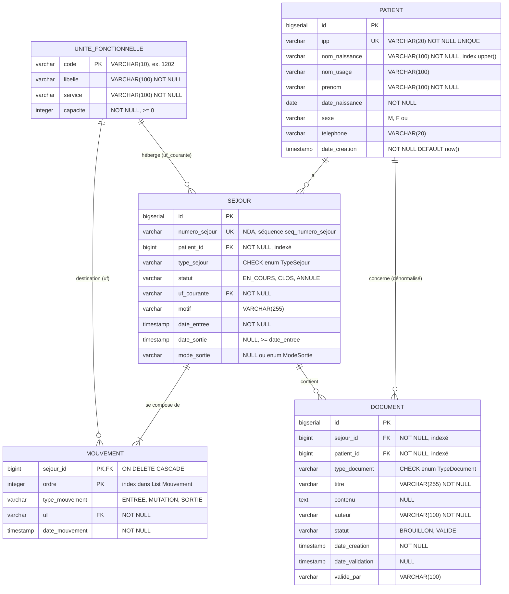
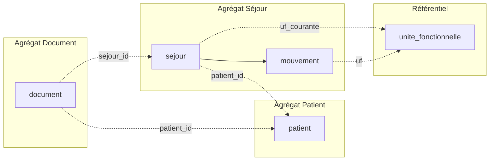

# Schéma de la base de données

Modèle physique PostgreSQL de l'application, créé par Liquibase à partir de
`src/main/resources/db/changelog/changes/001-schema.sql`. Le jeu de données de démonstration
(`002-donnees-demo.sql`) n'est chargé qu'avec le contexte Liquibase `demo`.

Le diagramme est au format **Mermaid** (rendu natif sur GitHub et GitLab, et dans IntelliJ ou VS Code
avec un plugin).

---

## 1. Diagramme entité-association

---

## 2. Description des tables

| Table | Rôle | Clé | Remarques |
|---|---|---|---|
| `unite_fonctionnelle` | Référentiel des unités fonctionnelles (UF) | `code` (clé **naturelle**) | Données de référence, non modifiées par l'API |
| `patient` | Agrégat **Patient** | `id` (`BIGSERIAL`) | `ipp` unique ; index sur `upper(nom_naissance)` pour la recherche insensible à la casse |
| `sejour` | Agrégat **Séjour** (racine) | `id` | `numero_sejour` (NDA) généré par la séquence `seq_numero_sejour` à partir de 1000 |
| `mouvement` | Entité **interne** à l'agrégat Séjour | (`sejour_id`, `ordre`) | Pas d'`id` propre : c'est la `List<Mouvement>` du séjour |
| `document` | Agrégat **Document** | `id` | `patient_id` **dénormalisé** (déductible via le séjour) pour accélérer les recherches |

### Contraintes d'intégrité

- **Énumérations** : stockées en `VARCHAR`, avec une contrainte `CHECK` qui reprend les valeurs des enums
  GraphQL et Java (`sexe`, `type_sejour`, `statut`, `mode_sortie`, `type_mouvement`, `type_document`).
- **Chronologie** : `ck_sejour_dates` impose `date_sortie >= date_entree`.
- **Capacité** : `capacite >= 0` (0 pour une UF de consultation, sans lit).
- **Clés étrangères** : toutes les relations sont protégées, et seule `mouvement → sejour` est en
  `ON DELETE CASCADE`, puisque les mouvements n'existent pas sans leur séjour.

### Index

| Index | Usage |
|---|---|
| `idx_patient_nom_naissance` sur `upper(nom_naissance)` | Filtre `patients(filtre: { nom })` insensible à la casse |
| `idx_sejour_patient` sur `patient_id` | Chargement en lot `Patient.sejours` (`WHERE patient_id IN (...)`) |
| `idx_sejour_statut_uf` sur (`statut`, `uf_courante`) | `UniteFonctionnelle.sejoursEnCours`, statistiques d'occupation |
| `idx_document_sejour` sur `sejour_id` | Chargement en lot `Sejour.documents` |
| `idx_document_patient` sur `patient_id` | Chargement en lot `Patient.documents`, filtre `documents(filtre: { patientId })` |

Les index servent directement les requêtes **en lot** des `@BatchMapping` : un DataLoader n'apporte un vrai
gain que si le `WHERE ... IN (...)` qu'il génère est indexé.

---

## 3. Les agrégats (Spring Data JDBC)

Le projet utilise **Spring Data JDBC**, et non JPA. Chaque **agrégat** est chargé et sauvegardé d'un bloc
par son repository, et les agrégats se référencent **par identifiant**, jamais par objet.

- Trait plein : **composition**, dans le même agrégat. Les mouvements sont lus et écrits avec le séjour.
  À chaque sauvegarde, Spring Data JDBC les supprime puis les réinsère, d'où la clé (`sejour_id`, `ordre`).
- Pointillés : **référence par id** vers un autre agrégat. Il n'y a pas de chargement automatique :
  c'est la couche GraphQL qui suit ces liens, à la demande, avec des `@BatchMapping`.

---

## 4. Correspondance base ↔ schéma GraphQL

Le schéma GraphQL **n'est pas** une copie de la base. Il expose un modèle pensé pour le client :

| GraphQL | Base de données | Différence |
|---|---|---|
| `Patient.nomAffiche`, `age`, `estMineur` | — | Champs **calculés** à partir de `nom_*` et `date_naissance` |
| `Patient.sejours` | `sejour.patient_id` | La clé étrangère devient une **relation navigable** |
| `Patient.sejourEnCours` | `sejour` avec `statut = 'EN_COURS'` | Relation filtrée |
| `Patient.documents(type)` | `document.patient_id` | Relation avec **argument** |
| `Sejour.ufCourante` | `sejour.uf_courante` | Code → objet `UniteFonctionnelle` complet |
| `Sejour.dureeJours`, `estEnCours` | — | Calculés |
| `Sejour.mouvements` | table `mouvement` | La colonne `ordre` n'est pas exposée : seul l'ordre de la liste compte |
| `Mouvement.uniteFonctionnelle` / `ufCode` | `mouvement.uf` | `ufCode` est **déprécié** au profit de l'objet |
| `Document.contenu(longueurMax)` | `document.contenu` | Champ avec argument : tronqué à la demande |
| `Document.taille` | — | Calculé (longueur du contenu) |
| `Document.patient` | `document.patient_id` | Exposé comme relation, bien que dénormalisé en base |
| `UniteFonctionnelle.sejoursEnCours`, `tauxOccupation` | — | Agrégations calculées |
| `Statistiques.*` | — | Requêtes SQL d'agrégation (`COUNT`, `AVG`…), une par champ |
| `Noeud`, `Resultat…`, `ErreurMetier`, `…Page` | — | Types **purement API**, sans table |
| Enums GraphQL | `VARCHAR` + `CHECK` | Mêmes valeurs dans les trois couches (SQL, Java, GraphQL) |
| Nommage `camelCase` | Nommage `snake_case` | Conversion faite par Spring Data JDBC |

---

Voir aussi : [diagramme du schéma GraphQL](schema-graphql.md) et
[DataFetcher, DataLoader et Repository](dataloader-datafetcher.md).
