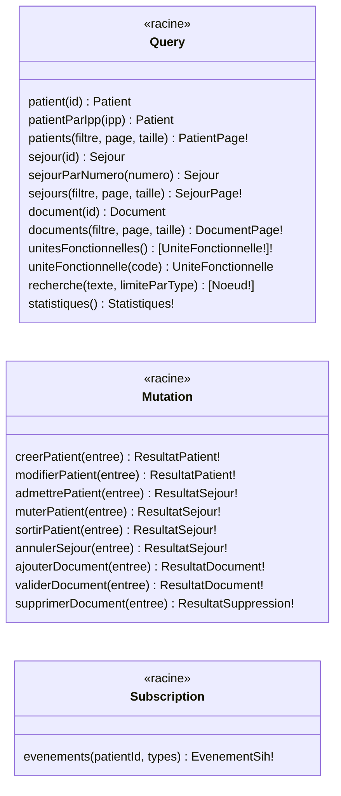
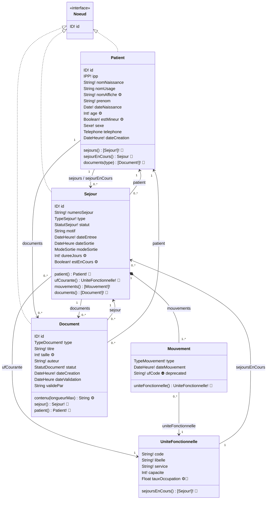
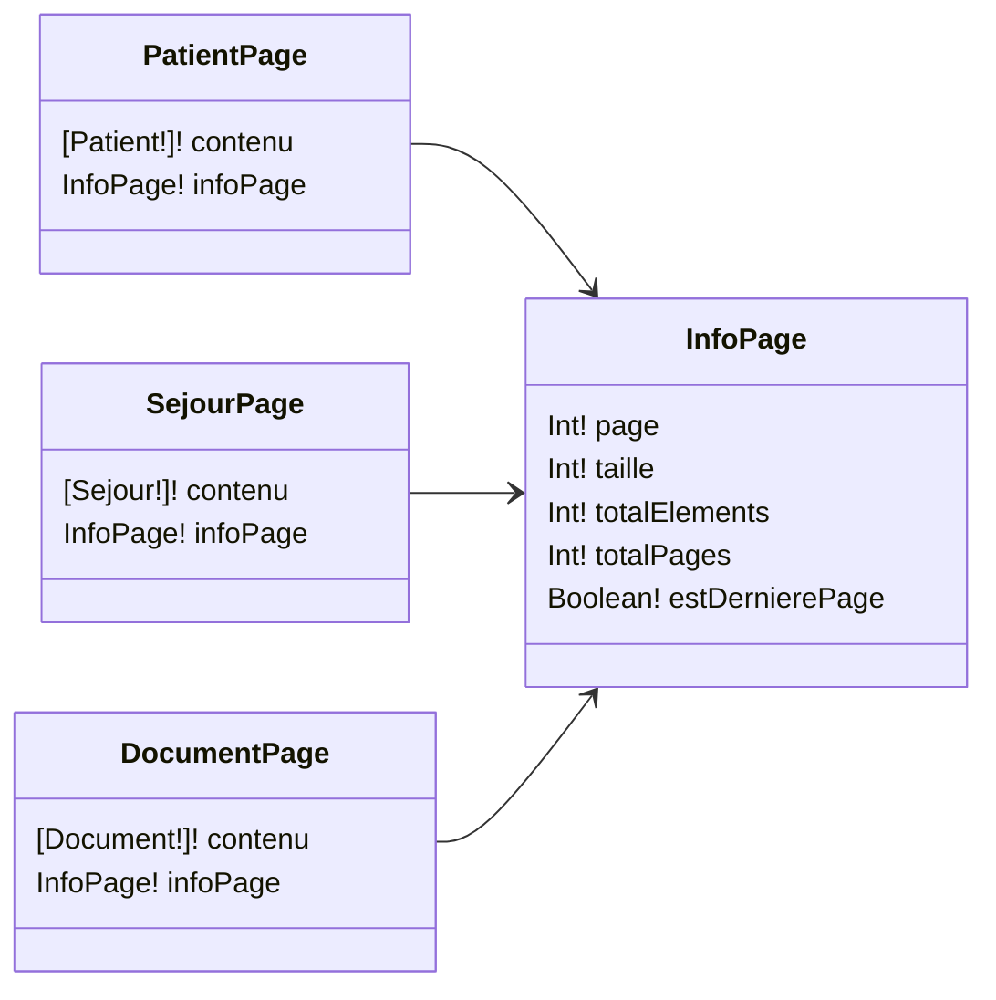
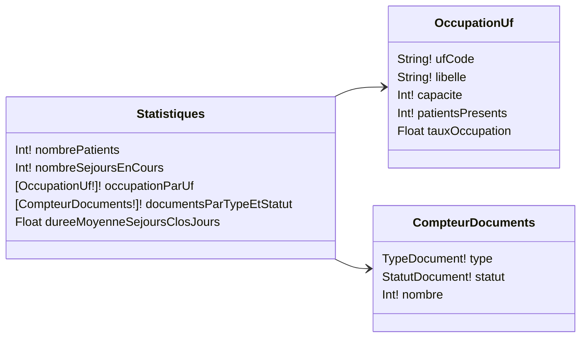
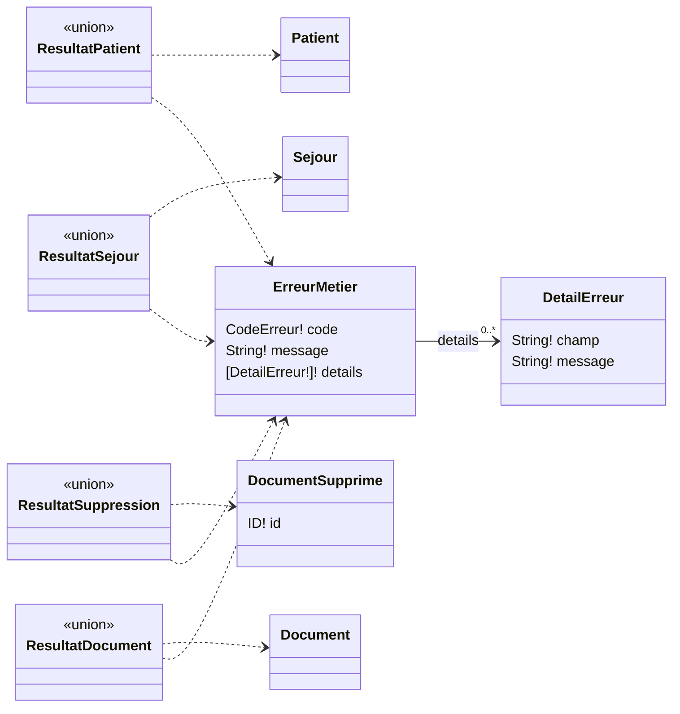
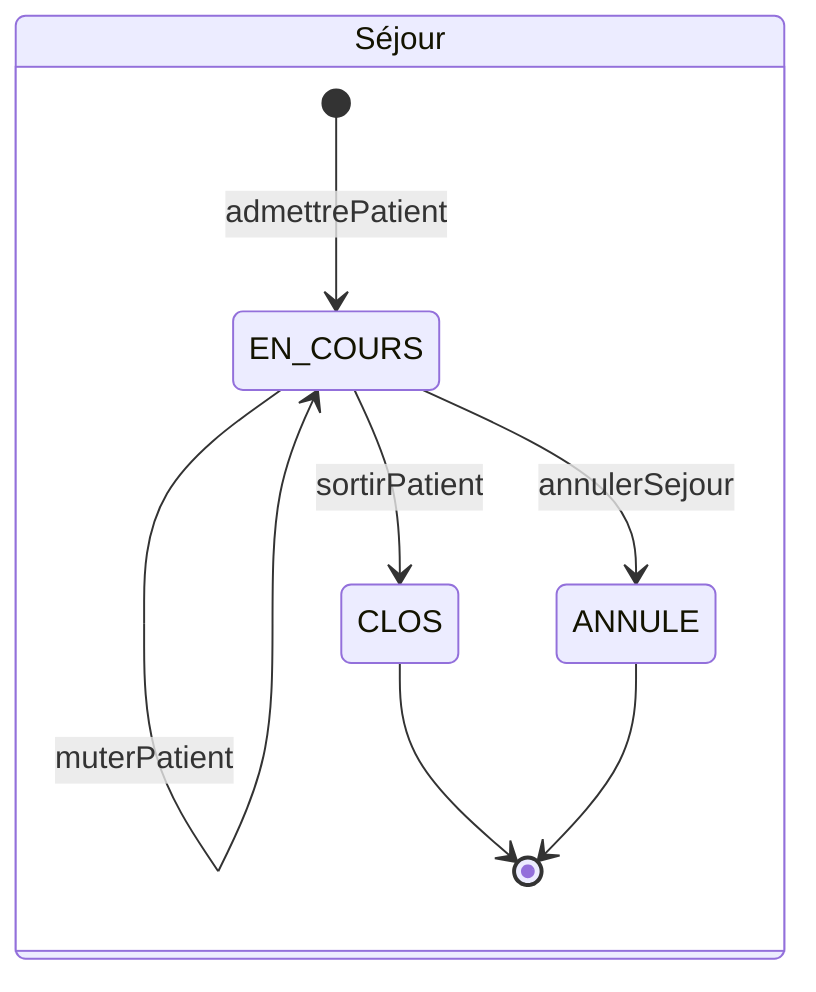
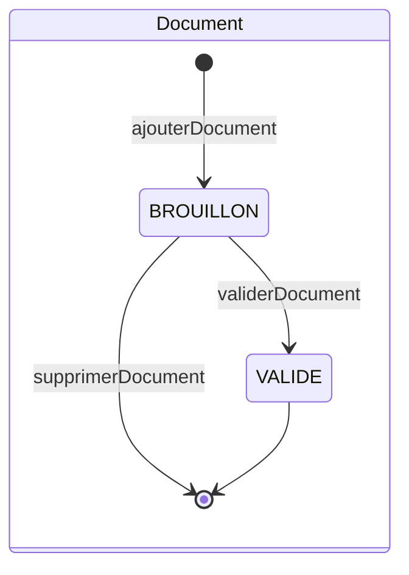

# Diagramme du schéma GraphQL

Représentation visuelle du schéma GraphQL de l'application, écrit dans `src/main/resources/graphql/`
(`commun.graphqls`, `patient.graphqls`, `sejour.graphqls`, `document.graphqls`).

Les diagrammes sont au format **Mermaid**. Ils s'affichent directement sur GitHub et GitLab, dans IntelliJ
(plugin Mermaid ou aperçu Markdown) et dans VS Code (extension *Markdown Preview Mermaid Support*).

Pour plus de lisibilité, le schéma est découpé en cinq vues :

1. [Les points d'entrée](#1-les-points-dentrée-query-mutation-subscription) : `Query`, `Mutation`, `Subscription`
2. [Le graphe des objets métier](#2-le-graphe-des-objets-métier) : `Patient`, `Sejour`, `Document`…
3. [Les résultats de mutation et les erreurs](#3-résultats-de-mutation-et-erreurs-métier) : unions `Resultat…`
4. [Les événements temps réel](#4-événements-temps-réel-subscription)
5. [Les énumérations, inputs et scalaires](#5-énumérations-inputs-et-scalaires)

Notation : `!` = non null, `[X]` = liste de X, `«interface»`, `«union»`, `«enum»`, `«input»` = nature du type.

---

## 1. Les points d'entrée (Query, Mutation, Subscription)

Toute requête commence par un champ d'un de ces trois types racines.

| Domaine | Lecture (`Query`) | Écriture (`Mutation`) |
|---|---|---|
| Patients | `patient`, `patientParIpp`, `patients` | `creerPatient`, `modifierPatient` |
| Séjours | `sejour`, `sejourParNumero`, `sejours` | `admettrePatient`, `muterPatient`, `sortirPatient`, `annulerSejour` |
| Documents | `document`, `documents` | `ajouterDocument`, `validerDocument`, `supprimerDocument` |
| Transverse | `recherche`, `statistiques`, `unitesFonctionnelles`, `uniteFonctionnelle` | — |

Les listes `patients`, `sejours` et `documents` sont **paginées** : elles renvoient une `…Page`
avec `contenu` et `infoPage`.

---

## 2. Le graphe des objets métier

C'est le cœur du schéma : les types et leurs **relations navigables**. Toutes les flèches peuvent être
parcourues dans une requête (patient → séjours → documents → patient…), d'où le nom « graphe ».

**Légende**

| Symbole | Signification | Côté serveur |
|---|---|---|
| ⚙ | Champ **calculé**, absent de la base | `@SchemaMapping` (ex. `age`, `contenu(longueurMax)`) ou méthode du record Java |
| 🔗 | **Relation** vers un autre agrégat, chargée à la demande | `@BatchMapping` dans `RelationsController` (sauf `sejourEnCours`, laissé exprès en `@SchemaMapping` pour montrer le N+1) |
| ⛔ | Champ **déprécié** (`@deprecated`) | Toujours servi, mais signalé par l'introspection (requête q17) |
| `*--` | Composition : les mouvements **appartiennent** au séjour | Chargés avec le séjour (même agrégat Spring Data JDBC) |

**Types de pagination** (non représentés ci-dessus) :

**Statistiques** : chaque champ est calculé par une requête SQL dédiée, exécutée seulement si le champ est demandé.

---

## 3. Résultats de mutation et erreurs métier

Chaque mutation renvoie une **union** : soit l'objet dans son nouvel état, soit une `ErreurMetier`.
Le client distingue les deux avec `__typename` et des fragments inline (`... on ErreurMetier { code }`).

| Mutation | Union renvoyée | Codes d'erreur possibles |
|---|---|---|
| `creerPatient` | `ResultatPatient` | `VALIDATION`, `IPP_DEJA_UTILISE`, `DATE_NAISSANCE_FUTURE` |
| `modifierPatient` | `ResultatPatient` | `VALIDATION`, `RESSOURCE_INTROUVABLE` |
| `admettrePatient` | `ResultatSejour` | `VALIDATION`, `RESSOURCE_INTROUVABLE`, `SEJOUR_DEJA_EN_COURS`, `DATE_FUTURE` |
| `muterPatient` | `ResultatSejour` | `RESSOURCE_INTROUVABLE`, `SEJOUR_NON_EN_COURS`, `MUTATION_MEME_UF`, `CHRONOLOGIE_INVALIDE` |
| `sortirPatient` | `ResultatSejour` | `RESSOURCE_INTROUVABLE`, `SEJOUR_NON_EN_COURS`, `LETTRE_LIAISON_MANQUANTE`, `CHRONOLOGIE_INVALIDE` |
| `annulerSejour` | `ResultatSejour` | `RESSOURCE_INTROUVABLE`, `SEJOUR_NON_EN_COURS` |
| `ajouterDocument` | `ResultatDocument` | `VALIDATION`, `RESSOURCE_INTROUVABLE`, `SEJOUR_ANNULE` |
| `validerDocument` | `ResultatDocument` | `VALIDATION`, `RESSOURCE_INTROUVABLE`, `DOCUMENT_DEJA_VALIDE` |
| `supprimerDocument` | `ResultatSuppression` | `RESSOURCE_INTROUVABLE`, `DOCUMENT_VALIDE_NON_SUPPRIMABLE` |

Les codes `PAGINATION_INVALIDE` et `RECHERCHE_TROP_COURTE` concernent des **queries** : ils arrivent dans
le tableau `errors` de la réponse, pas dans une union.

---

## 4. Événements temps réel (Subscription)

`Subscription.evenements` renvoie l'interface `EvenementSih`. Une mutation réussie publie un événement,
qui est envoyé aux abonnés par WebSocket (`/graphql-ws`).

```mermaid
classDiagram
    direction LR

    class EvenementSih {
        <<interface>>
        TypeEvenement! type
        DateHeure! horodatage
    }
    class EvenementSejour {
        TypeEvenement! type
        DateHeure! horodatage
        Sejour! sejour
    }
    class EvenementDocument {
        TypeEvenement! type
        DateHeure! horodatage
        Document! document
    }

    EvenementSih <|.. EvenementSejour
    EvenementSih <|.. EvenementDocument
    EvenementSejour --> Sejour : état APRÈS l'événement
    EvenementDocument --> Document : état APRÈS l'événement
```

| Mutation | Événement publié | Type |
|---|---|---|
| `admettrePatient` | `ADMISSION` | `EvenementSejour` |
| `muterPatient` | `MUTATION` | `EvenementSejour` |
| `sortirPatient` | `SORTIE` | `EvenementSejour` |
| `annulerSejour` | `ANNULATION` | `EvenementSejour` |
| `ajouterDocument` | `DOCUMENT_AJOUTE` | `EvenementDocument` |
| `validerDocument` | `DOCUMENT_VALIDE` | `EvenementDocument` |

---

## 5. Énumérations, inputs et scalaires

### Scalaires personnalisés

| Scalaire | Format | Exemple | Validé |
|---|---|---|---|
| `Date` | `yyyy-MM-dd` | `1948-03-12` | avant exécution |
| `DateHeure` | `yyyy-MM-dd'T'HH:mm:ss`, heure locale | `2026-11-18T09:30:00` | avant exécution |
| `IPP` | exactement 8 chiffres | `00010001` | avant exécution |
| `Telephone` | 10 chiffres commençant par 0 | `0612345678` | avant exécution |

### Énumérations

| Enum | Valeurs |
|---|---|
| `Sexe` | `M`, `F`, `I` |
| `TypeSejour` | `HOSPITALISATION_COMPLETE`, `AMBULATOIRE`, `URGENCES`, `CONSULTATION_EXTERNE` |
| `StatutSejour` | `EN_COURS`, `CLOS`, `ANNULE` |
| `TypeMouvement` | `ENTREE`, `MUTATION`, `SORTIE` |
| `ModeSortie` | `DOMICILE`, `TRANSFERT`, `DECES`, `CONTRE_AVIS_MEDICAL` |
| `TypeDocument` | `COMPTE_RENDU_HOSPITALISATION`, `COMPTE_RENDU_OPERATOIRE`, `COMPTE_RENDU_CONSULTATION`, `COMPTE_RENDU_IMAGERIE`, `LETTRE_DE_LIAISON`, `ORDONNANCE`, `RESULTAT_BIOLOGIE` |
| `StatutDocument` | `BROUILLON`, `VALIDE` |
| `TypeEvenement` | `ADMISSION`, `MUTATION`, `SORTIE`, `ANNULATION`, `DOCUMENT_AJOUTE`, `DOCUMENT_VALIDE` |
| `CodeErreur` | voir le tableau de la section 3 (+ `PAGINATION_INVALIDE`, `RECHERCHE_TROP_COURTE`) |

### Cycles de vie

### Inputs (arguments des mutations et filtres)

```mermaid
classDiagram
    direction LR
    class CreerPatientInput {
        <<input>>
        IPP! ipp
        String! nomNaissance
        String nomUsage
        String! prenom
        Date! dateNaissance
        Sexe! sexe
        Telephone telephone
    }
    class ModifierPatientInput {
        <<input>>
        ID! patientId
        String nomNaissance
        String nomUsage
        String prenom
        Telephone telephone
    }
    class AdmissionInput {
        <<input>>
        ID! patientId
        TypeSejour! type
        String! ufCode
        String motif
        DateHeure dateEntree
    }
    class MutationPatientInput {
        <<input>>
        ID! sejourId
        String! ufDestination
        DateHeure dateMutation
    }
    class SortieInput {
        <<input>>
        ID! sejourId
        ModeSortie! modeSortie
        DateHeure dateSortie
    }
    class AnnulationSejourInput {
        <<input>>
        ID! sejourId
    }
    class AjoutDocumentInput {
        <<input>>
        ID! sejourId
        TypeDocument! type
        String! titre
        String contenu
        String! auteur
    }
    class ValidationDocumentInput {
        <<input>>
        ID! documentId
        String! validePar
    }
    class SuppressionDocumentInput {
        <<input>>
        ID! documentId
    }
```

```mermaid
classDiagram
    direction LR
    class FiltrePatient {
        <<input>>
        String nom
        String prenom
        Sexe sexe
        Date neApres
        Date neAvant
    }
    class FiltreSejour {
        <<input>>
        ID patientId
        [StatutSejour!] statuts
        TypeSejour type
        String ufCode
        DateHeure entreApres
        DateHeure entreAvant
    }
    class FiltreDocument {
        <<input>>
        ID patientId
        ID sejourId
        [TypeDocument!] types
        StatutDocument statut
        String auteur
        String titreContient
    }
```

---

Voir aussi : [schéma de la base de données](schema-bdd.md), qui montre comment ces types sont stockés,
et [lexique GraphQL](lexique-graphql.md) pour le vocabulaire.
